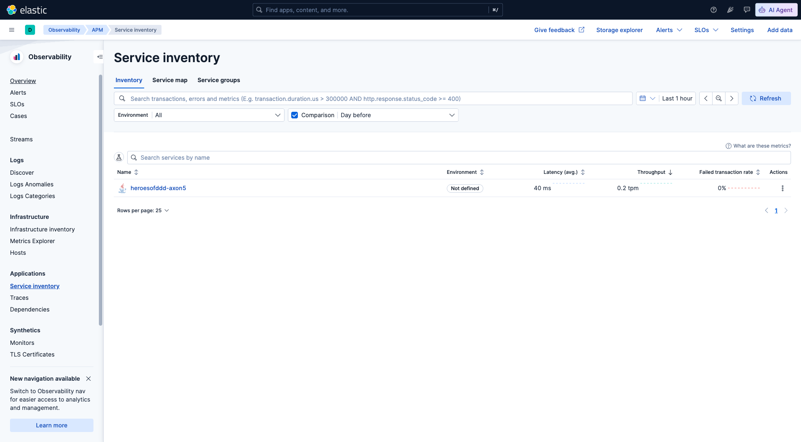
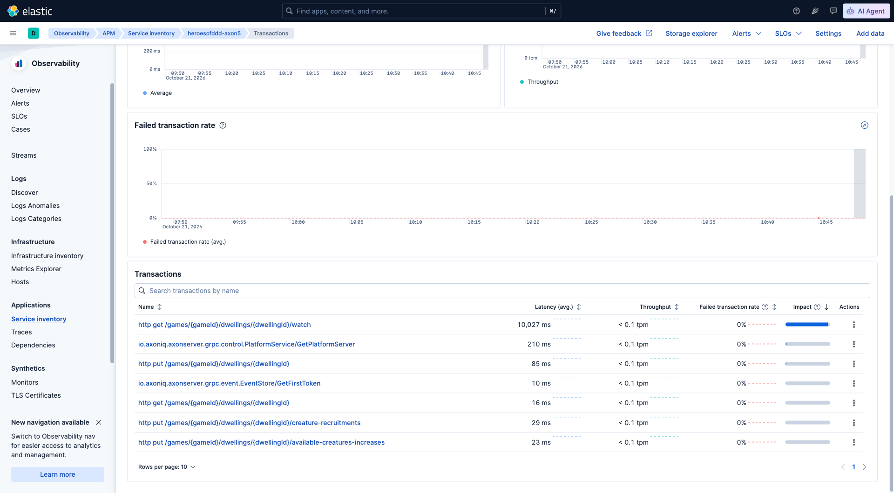
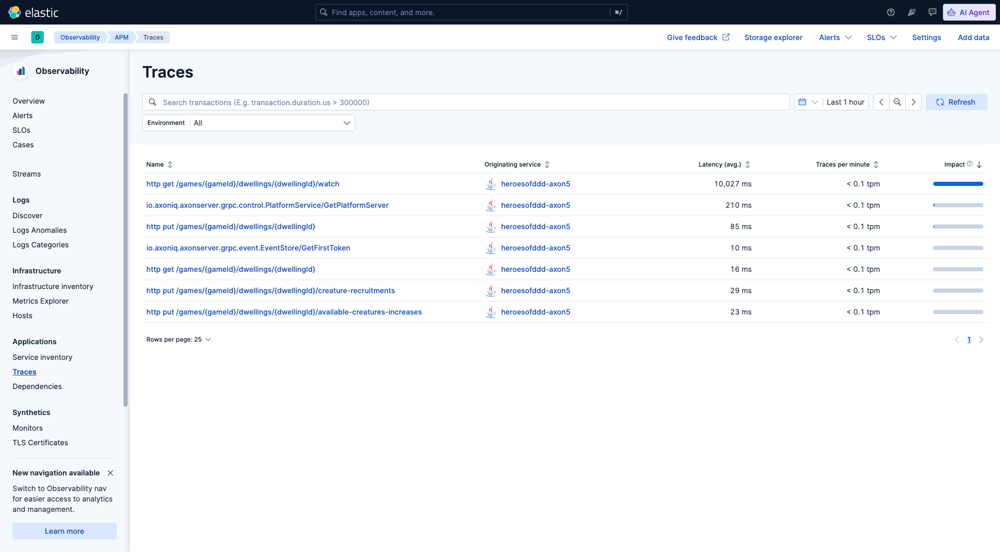
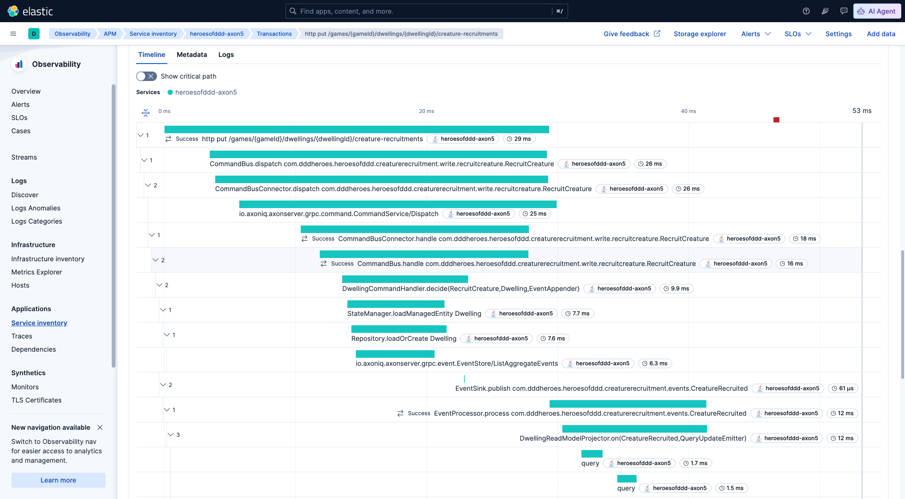
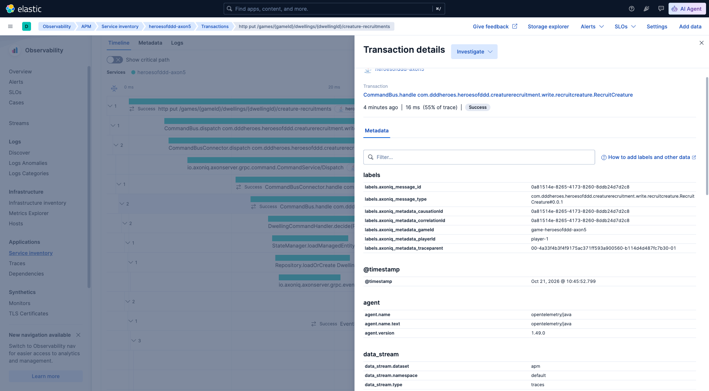
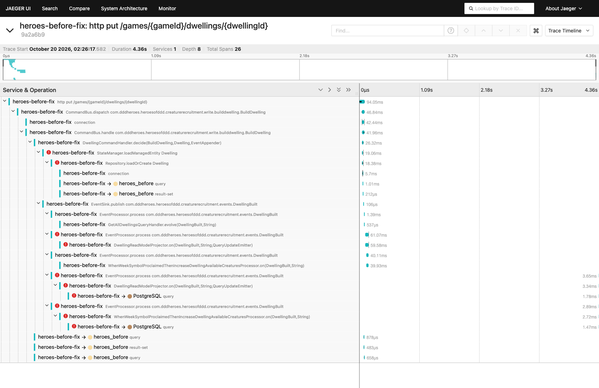
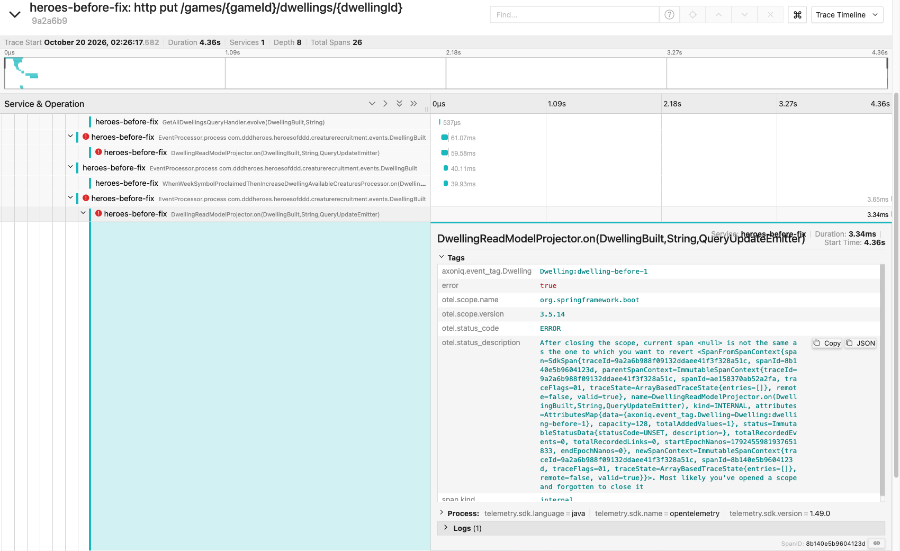
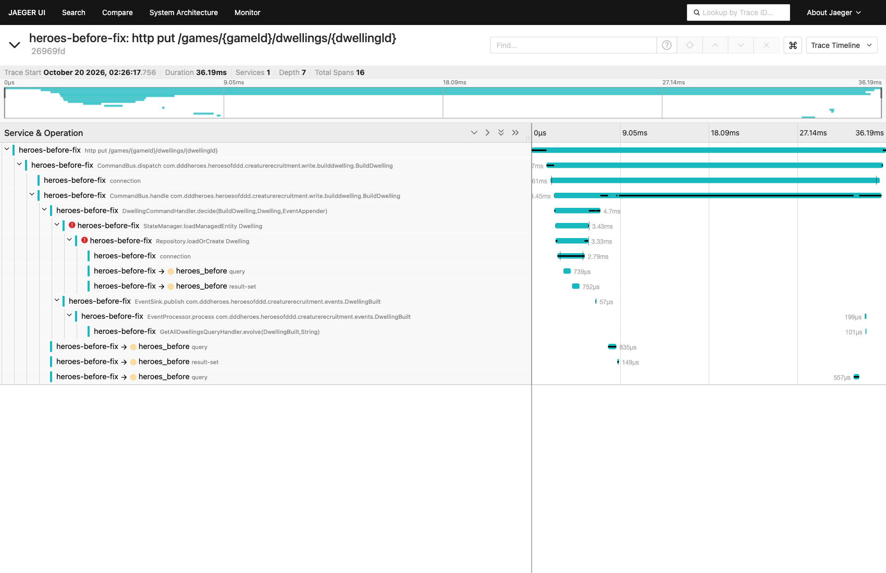
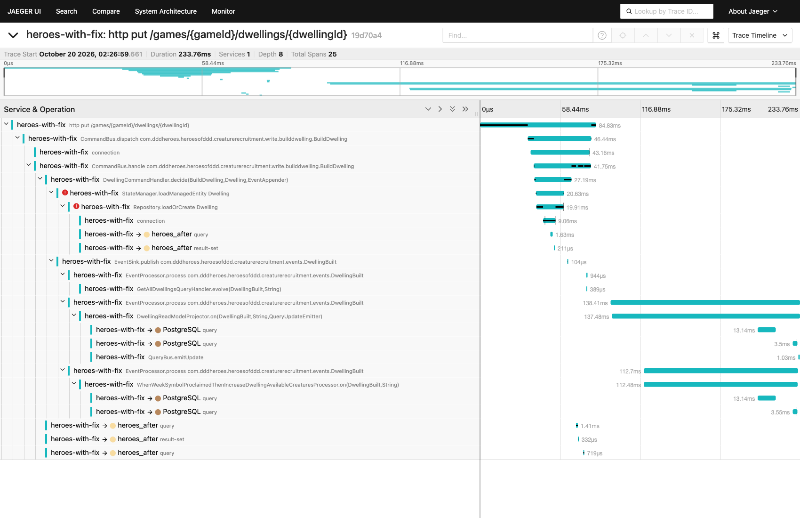

# 📊 Observability — distributed tracing

The app can emit distributed traces to either **Elastic APM** or **Jaeger** via OpenTelemetry. Tracing is **off by default** and activated by one of two Spring profiles, each paired with its own Docker Compose overlay.

> 👉 Back to the [main README](../README.md).

## Table of contents

1. [Backends — pick one](#backends--pick-one)
2. [Stack components](#stack-components)
3. [Run with Elastic APM](#run-with-elastic-apm)
4. [Run with Jaeger](#run-with-jaeger)
5. [Run without tracing (default)](#run-without-tracing-default)
6. [Ports & URLs](#ports--urls)
7. [Exploring traces in Kibana — guided tour](#exploring-traces-in-kibana--guided-tour)
8. [Same traces in Jaeger](#same-traces-in-jaeger)
9. [Useful filters](#useful-filters)
10. [JDBC / SQL spans](#jdbc--sql-spans)
11. [R2DBC / SQL spans](#r2dbc--sql-spans)
12. [gRPC spans (Axon Server connector)](#grpc-spans-axon-server-connector)
13. [Reading reactive traces — causality vs. containment](#reading-reactive-traces--causality-vs-containment)
14. [When a request spans more than one trace](#when-a-request-spans-more-than-one-trace)

## Backends — pick one

| Backend         | Spring profile             | Compose overlay                                  | Footprint    | UI                                  | When to use                                    |
|-----------------|----------------------------|--------------------------------------------------|--------------|-------------------------------------|------------------------------------------------|
| **Elastic APM** | `observability-elastic`    | `docker-compose.observability-elastic.yaml`      | ~2 GB RAM    | Kibana APM (rich, service map, KQL) | Production-realistic UX, queries, dashboards   |
| **Jaeger**      | `observability-jaeger`     | `docker-compose.observability-jaeger.yaml`       | ~150 MB RAM  | Jaeger UI (simple waterfall)        | Quick spin-up, demos, CI, constrained machines |

The two profiles are **alternatives** — pick the backend you want for a given session. The base `observability` profile (sampling, OTLP/HTTP transport, Axon `OpenTelemetrySpanFactory` wiring) is inherited by both via Spring's `spring.profiles.group`, so switching backends is a one-line change.

## Stack components

| Component | Role |
|---|---|
| [`axon-tracing-opentelemetry`](https://docs.axoniq.io/axon-framework-reference/4.13/monitoring/tracing/) | Instruments command/event/query handlers, aggregates, repositories, event store |
| [`micrometer-tracing-bridge-otel`](https://docs.spring.io/spring-boot/reference/actuator/tracing.html) | Spring Boot's official bridge from Micrometer Observation to OpenTelemetry |
| [`opentelemetry-exporter-otlp`](https://opentelemetry.io/docs/specs/otlp/) | Pushes traces over OTLP/HTTP to the chosen backend |
| [`datasource-micrometer-spring-boot`](https://github.com/jdbc-observations/datasource-micrometer) | Wraps the HikariCP `DataSource` so each JDBC connection/query becomes a child span carrying the SQL text and bind parameters. Runtime gate: `jdbc.datasource-proxy.enabled` |
| [`r2dbc-proxy`](https://github.com/r2dbc/r2dbc-proxy) | Activates Spring Boot's own `R2dbcObservationAutoConfiguration`, which wraps the reactive `ConnectionFactory` so each read-model query becomes a Micrometer Observation → child span. The parent is resolved from the Reactor Context captured at subscription. Runtime gate: `management.observations.enable.r2dbc` |
| [`opentelemetry-grpc-1.6`](https://opentelemetry.io/docs/languages/java/instrumentation/) | Client interceptor on the Axon Server connector channel, producing gRPC client spans (only under an `axonserver` profile) |
| [Elastic APM 9.x](https://www.elastic.co/observability/application-performance-monitoring) | Receives OTLP, stores in Elasticsearch, visualizes in Kibana |
| [Jaeger 2.x](https://www.jaegertracing.io/) | Receives OTLP directly, in-memory storage, lightweight UI |

Activation surface:
- Base profile **`observability`** — common tracing config (sampling, transport, Axon span factory bean). Never activated directly.
- Profile **`observability-elastic`** — base + Elastic APM endpoint
- Profile **`observability-jaeger`** — base + Jaeger endpoint
- Profile groups in `application.yaml` make the two child profiles automatically include the base.

Instrumentation JARs (JDBC, R2DBC, gRPC) are always on the classpath; each feature is gated at **runtime** only:
the `observability` profile plus the feature's enabled property (`jdbc.datasource-proxy.enabled`,
`management.observations.enable.r2dbc`, or `axon.axonserver.enabled`) must be active before spans appear.
Normal runs (no observability profile) carry no per-query observations.

## Run with Elastic APM

1. Start the base stack + Elastic observability stack:
   ```bash
   docker compose -f docker-compose.yaml -f docker-compose.observability-elastic.yaml up -d
   ```
   Wait ~60s for Elasticsearch and Kibana to be ready.

2. Run the app with the `observability-elastic` profile:
   ```bash
   SPRING_PROFILES_ACTIVE=observability-elastic ./mvnw spring-boot:run
   ```
   Or: `./mvnw spring-boot:run -Dspring-boot.run.profiles=observability-elastic`.

3. Generate some traffic via Swagger UI at [http://localhost:3773/swagger-ui/index.html](http://localhost:3773/swagger-ui/index.html).

4. Open Kibana APM — see [the guided tour below](#exploring-traces-in-kibana--guided-tour).

## Run with Jaeger

1. Start the base stack + Jaeger:
   ```bash
   docker compose -f docker-compose.yaml -f docker-compose.observability-jaeger.yaml up -d
   ```
   Jaeger v2 starts in seconds — UI is ready almost immediately.

2. Run the app with the `observability-jaeger` profile:
   ```bash
   SPRING_PROFILES_ACTIVE=observability-jaeger ./mvnw spring-boot:run
   ```
   Or: `./mvnw spring-boot:run -Dspring-boot.run.profiles=observability-jaeger`.

3. Generate some traffic via Swagger UI at [http://localhost:3773/swagger-ui/index.html](http://localhost:3773/swagger-ui/index.html).

4. Open Jaeger UI at [http://localhost:16686](http://localhost:16686) — see [Same traces in Jaeger](#same-traces-in-jaeger) below.

## Run without tracing (default)

```bash
docker compose up -d
./mvnw spring-boot:run
```

No `observability-*` profile = no traces emitted, no extra containers needed. Useful for daily development.

## Ports & URLs

| Service                              | Port  | URL                                                                                | Used by profile           |
|--------------------------------------|-------|------------------------------------------------------------------------------------|---------------------------|
| Kibana (APM UI)                      | 5601  | [http://localhost:5601](http://localhost:5601)                                     | `observability-elastic`   |
| Kibana → APM → Services              |       | [http://localhost:5601/app/apm/services](http://localhost:5601/app/apm/services)   | `observability-elastic`   |
| Kibana → APM → Traces                |       | [http://localhost:5601/app/apm/traces](http://localhost:5601/app/apm/traces)       | `observability-elastic`   |
| Elasticsearch                        | 9200  | [http://localhost:9200](http://localhost:9200)                                     | `observability-elastic`   |
| Elastic APM Server (OTLP receiver)   | 8200  | [http://localhost:8200/v1/traces](http://localhost:8200/v1/traces)                 | `observability-elastic`   |
| Jaeger UI                            | 16686 | [http://localhost:16686](http://localhost:16686)                                   | `observability-jaeger`    |
| Jaeger OTLP receiver (HTTP)          | 4318  | [http://localhost:4318/v1/traces](http://localhost:4318/v1/traces)                 | `observability-jaeger`    |
| Jaeger OTLP receiver (gRPC)          | 4317  | grpc://localhost:4317                                                              | `observability-jaeger`    |

## Exploring traces in Kibana — guided tour

A quick walkthrough of what you can see and where to click. The captures below come from running the
`generated-requests.http` flow (`BuildDwelling` twice, `GetDwellingById`, the `WatchDwelling` subscription,
`IncreaseAvailableCreatures`, `RecruitCreature`) with `SPRING_PROFILES_ACTIVE=observability-elastic,axonserver-aggregate`,
so commands travel through Axon Server.

### 1. Service inventory

[Kibana -> ☰ -> Observability -> APM -> Services](http://localhost:5601/app/apm/services) - landing page lists every service emitting traces. After firing a few requests you should see `heroesofddd-axon5` with average latency, throughput, and error rate.



### 2. Transactions

Click `heroesofddd-axon5` -> **Transactions** tab. With the default transaction type `request` the table lists the HTTP
endpoints (auto-instrumented by Spring WebFlux) and the Axon Server connector's own background gRPC calls
(`EventStore/GetFirstToken`, `PlatformService/GetPlatformServer`). Switch **Transaction type** to `unknown` to list the
Axon handlers (`CommandBus.handle ...`, `CommandBusConnector.handle ...`, `EventProcessor.process ...`, `QueryBus.handle ...`).
Elastic APM shows those as transactions because of their span kind, but they are not separate traces: each one sits
inside the trace of the request that caused it.



### 3. Traces - the full list

[Kibana -> APM -> Traces](http://localhost:5601/app/apm/traces) shows every individual trace tree, by its root.

For this project the roots are:
- `http put /games/{gameId}/dwellings/{dwellingId}` and the other HTTP endpoints, one trace per request
- `io.axoniq.axonserver.grpc.event.EventStore/GetFirstToken` and `...PlatformService/GetPlatformServer`, background
  calls of the Axon Server connector, not tied to any request

Commands, event processors, automations and their follow-up commands do **not** appear as roots: they continue the
request's trace (see [When a request spans more than one trace](#when-a-request-spans-more-than-one-trace)).



### 4. Trace waterfall - Axon internals visible

Click the `http put .../creature-recruitments` trace and Kibana renders the whole request as one waterfall - the HTTP
call, the command's hop through Axon Server, the command handler, event publication, the projector with its SQL, and
the automation's follow-up command:



What you're looking at (durations from the capture above, names shortened):

```
✓ http put /games/{gameId}/dwellings/{dwellingId}/creature-recruitments             29 ms
  └─ CommandBus.dispatch ...RecruitCreature                                         26 ms
     └─ CommandBusConnector.dispatch ...RecruitCreature                             26 ms   <- gRPC to Axon Server
        ├─ CommandService/Dispatch                                                  25 ms
        └─ CommandBusConnector.handle ...RecruitCreature                            18 ms   <- handling side of the hop
           └─ CommandBus.handle ...RecruitCreature                                  16 ms
              ├─ DwellingCommandHandler.decide(RecruitCreature,...)                9.9 ms   <- business logic
              │  ├─ StateManager.loadManagedEntity Dwelling                        7.7 ms
              │  │  └─ Repository.loadOrCreate Dwelling                            7.6 ms   <- event sourcing
              │  │     └─ EventStore/ListAggregateEvents                           6.3 ms
              │  └─ EventSink.publish ...CreatureRecruited                          61 μs
              │     ├─ EventProcessor.process ...CreatureRecruited                  12 ms   <- ReadModel_Dwelling
              │     │  └─ DwellingReadModelProjector.on(CreatureRecruited,...)      12 ms
              │     │     ├─ query / query                                                  <- R2DBC read-model queries
              │     │     └─ QueryBus.emitUpdate                                            <- subscription-query update
              │     └─ EventProcessor.process ...CreatureRecruited                          <- automation processor
              │        └─ WhenCreatureRecruitedThenAddToArmyProcessor.react(...)
              │           └─ CommandBus.dispatch ...AddCreatureToArmy                       <- follow-up command, same trace
              └─ EventStore/AppendEvent
```

### 5. Span attributes - gameId, playerId, message metadata

Click any Axon span (e.g. `CommandBus.handle ...RecruitCreature`) -> **Metadata**. The `labels` section shows the
message identity and the message's metadata - including the correlation data injected by `GameConfiguration.gameDataProvider`:



```
labels.axoniq_message_id                = 0a81514e-8265-4173-8260-...
labels.axoniq_message_type              = com.dddheroes...RecruitCreature#0.0.1
labels.axoniq_metadata_gameId           = game-...                       <- from gameDataProvider
labels.axoniq_metadata_playerId         = player-1                     <- from gameDataProvider
labels.axoniq_metadata_correlationId    = 0a81514e-...
labels.axoniq_metadata_causationId      = 0a81514e-...
labels.axoniq_metadata_traceparent      = 00-4a33f4b3...-b114d4d4...-01    <- trace context carried in the message
```

This is the practical payoff: filtering by `labels.axoniq_metadata_gameId : "scenario-1"` in the Kibana search bar isolates every Axon span - across every aggregate, processor and projector - that participated in one game session.

## Same traces in Jaeger

With `observability-jaeger` active, the **same** trace data is produced - Jaeger just renders it differently:

1. Open [http://localhost:16686](http://localhost:16686).
2. **Service** dropdown -> pick `heroesofddd-axon5`.
3. **Operation** dropdown -> e.g. `http put /games/{gameId}/dwellings/{dwellingId}/creature-recruitments`, or an Axon span such as `CommandBus.handle com.dddheroes.heroesofddd.creaturerecruitment.write.recruitcreature.RecruitCreature`.
4. Click **Find Traces** -> see the same waterfall tree (`CommandBusConnector.handle`, `DwellingCommandHandler.decide(...)`, `EventSink.publish`, `EventProcessor.process`, ...).
5. Click any span -> "Tags" panel shows the same attributes as Kibana labels, with dot-notation: `axoniq.message.id`, `axoniq.message.type`, `axoniq.metadata.gameId`, `axoniq.metadata.playerId`, etc.

Trade-offs vs Kibana APM:
- ✅ **Lighter** - one container, instant startup, no Elasticsearch index management
- ✅ **Simpler** - direct trace search by service / operation / tag / duration
- ❌ **No service map** - Kibana shows topology between services; Jaeger v2 OSS doesn't
- ❌ **No KQL** - Jaeger uses a simpler tag-equality search (`axoniq.metadata.gameId=scenario-1`) rather than full KQL
- ❌ **No persistence by default** - all-in-one stores traces in memory; restart loses them
- ❌ **No metrics/logs correlation** - Kibana correlates traces with the rest of the Elastic stack

## Useful filters

### Kibana (KQL)

Paste into the Kibana search bar (KQL) at the top of any APM page:

| Goal | KQL |
|---|---|
| Traces for one game | `labels.axoniq_metadata_gameId : "scenario-1"` |
| Only command handlers | `transaction.name : CommandBus.handle*` |
| Only one entity's decisions | `span.name : DwellingCommandHandler.decide*` |
| Only automation reactions | `span.name : *Processor.react*` |
| Only event publications | `span.name : EventSink.publish*` |

### Jaeger (Tags field)

In the Jaeger UI search form, the **Tags** field accepts space-separated `key=value` pairs:

| Goal | Tag query |
|---|---|
| Traces for one game | `axoniq.metadata.gameId=scenario-1` |
| One specific player's traces | `axoniq.metadata.playerId=player-1` |
| Combine | `axoniq.metadata.gameId=scenario-1 axoniq.metadata.playerId=player-1` |

(Operation-level filtering - e.g. "only `DwellingCommandHandler.decide` spans" - is done via the **Operation** dropdown, not the Tags field.)

## JDBC / SQL spans

Under the `observability` profile the app also instruments the JDBC layer via
[`datasource-micrometer-spring-boot`](https://github.com/jdbc-observations/datasource-micrometer).
It wraps the autoconfigured HikariCP `DataSource` in a proxy that emits a Micrometer Observation
per JDBC connection and query, so **every SQL statement becomes its own child span** nested under
the Axon span that triggered it:

- Axon **JPA event store** reads/appends and snapshot access → SQL spans under the event-store /
  aggregate-load spans.
- **Read-model projections** (`DwellingReadModel`, `BuiltDwellingReadModel`) → INSERT/UPDATE/SELECT
  spans under the projection event-handler spans.

Each query span carries the SQL text; `jdbc.datasource-proxy.include-parameter-values: true` also
attaches the bind-parameter values. This is instrumented purely at the `DataSource` layer — no
domain or infrastructure code changes — so all pooled SQL is captured automatically.

Gating: the proxy is **disabled by default** (`jdbc.datasource-proxy.enabled: false` in
`application.yaml`) and turned on only by the `observability` profile
(`application-observability.yaml`), matching the rest of the tracing setup — normal runs are
unaffected.

> ⚠️ Bind-parameter values can expose data. This is intentional here (local/dev tracing, off by
> default). Before enabling in any shared environment, revisit `include-parameter-values`.

## R2DBC / SQL spans

The reactive read models use Spring Data R2DBC, so JDBC instrumentation does not see their queries. R2DBC
tracing rides on Spring Boot's own [`R2dbcObservationAutoConfiguration`](https://docs.spring.io/spring-boot/api/java/org/springframework/boot/actuate/autoconfigure/r2dbc/R2dbcObservationAutoConfiguration.html),
activated by [`r2dbc-proxy`](https://github.com/r2dbc/r2dbc-proxy) on the classpath: it wraps the reactive
`ConnectionFactory` with `ObservationProxyExecutionListener`, so each query becomes a Micrometer Observation
(`r2dbc.query...`) flowing through the same `micrometer-tracing-bridge-otel` → OTLP pipeline as everything else.

```bash
SPRING_PROFILES_ACTIVE=observability-jaeger ./mvnw spring-boot:run
```

Every reactive SELECT, INSERT, and UPDATE issued by the read-model repositories becomes a database-client
span under the WebFlux request or Axon projection/query-handler span that initiated it. Crucially, the
listener resolves the parent from the **Reactor Context captured at subscription** (not from a thread-local
read at query time). Axoniq Framework carries the active handler as a raw Micrometer Tracing `Span` under
Micrometer's standard context key. A balanced accessor gives every nested set and clear operation an independent
scope, so Reactor restores the span safely across scheduler and driver thread changes without synthetic observations.
On Axoniq Framework 5.4.0 the app registers that accessor itself (`ReactorSpanScopeWorkaroundConfiguration`, see
regression 2 in [UPGRADE-AXON-5.4.0.md](UPGRADE-AXON-5.4.0.md)), because the fix is not released yet.
Queries whose I/O completes on the Postgres driver's shared Netty event-loop threads therefore still nest
correctly — the raw-OpenTelemetry `R2dbcTelemetry` wrapper used previously read
`Context.current()` on those threads and produced orphaned root spans instead.

Gating: `management.observations.enable.r2dbc` is `false` by default (`application.yaml`) and turned on by
the `observability` profile, which also sets `management.observations.r2dbc.include-parameter-values: true`
(same caveat as the JDBC bind-parameter values above). Normal runs therefore remain unchanged.

### Before and after the balanced span accessor

Micrometer's default `ObservationAwareSpanThreadLocalAccessor` loses a scope when Reactor clears the span inside
an already-restored span scope (a subscriber whose Reactor Context has no span, or the R2DBC driver subscribing
internally). The next restore then goes off by one: the outer span disappears, Micrometer's `assert` in
`restore(...)` fails, or the span stays current on a worker thread and leaks into unrelated work.
Axoniq Framework replaces that accessor with a balanced one
([AxonIQ/axoniq-framework PR 329](https://github.com/AxonIQ/axoniq-framework/pull/329)); the same fix is proposed
upstream in [micrometer-metrics/tracing PR 1614](https://github.com/micrometer-metrics/tracing/pull/1614).

The screenshots below come from the same `generated-requests.http` flow, run with `java -ea` (assertions on, as
Surefire runs tests) against a fresh database, once with the previous accessor (`heroes-before-fix`) and once with
the balanced one (`heroes-with-fix`).

**Before the fix, first `PUT .../dwellings/{dwellingId}`.** The `DwellingReadModelProjector` and
`WhenWeekSymbolProclaimed...` handlers end in `ERROR`, their R2DBC `INSERT` and the `QueryBus.emitUpdate` are
missing, and the read model is never written: the following `GET` returns an empty body and the subscription query
emits nothing. The second pair of failing handlers at the end of the trace (around 4.3 s) is the event processor's
retry after it released and re-claimed its segment; it fails the same way.



The failing span's status carries Micrometer's scope assertion:



**Before the fix, second `PUT`.** While their processors keep retrying the failed event, the projector and the
automation never handle the second dwelling, so their spans are missing from the trace (and from every other trace of
the run).



**With the fix.** Both handlers run their `SELECT` and `INSERT` under the handler span, the projector emits the
subscription-query update, and the read side works end to end (the watch stream shows `0 -> 5 -> 2`). The two
`ERROR` markers on `StateManager.loadManagedEntity` / `Repository.loadOrCreate` are the expected "entity not found"
path when a new dwelling is built and appear in both runs.



Without `-ea` the previous accessor does not fail the handlers, so the trace looks complete, but it still logs
`After closing the scope, current span ... is not the same as the one to which you want to revert` warnings and can
leave spans current on pooled threads.

## gRPC spans (Axon Server connector)

The only gRPC in this app is the connection to **Axon Server** (via `axonserver-connector-java`),
which is **disabled by default** — the app runs on the JPA event store. gRPC spans therefore only
appear when you run under an Axon Server profile *and* the `observability` profile, e.g.:

```bash
SPRING_PROFILES_ACTIVE=observability-jaeger,axonserver-dcb ./mvnw spring-boot:run
```

Instrumentation is an OpenTelemetry gRPC `ClientInterceptor` (`opentelemetry-grpc-1.6`) registered
on the connector channel through Axon 5's `ManagedChannelCustomizer` hook (see
`GrpcTracingConfiguration`). Spans carry the standard gRPC attributes (`rpc.system=grpc`,
`rpc.service`, `rpc.method`, `rpc.grpc.status_code`) and flow through the same OTLP pipeline as the
Axon/HTTP/JDBC spans. It is built from the shared `OpenTelemetry` SDK bean, so no extra export
wiring is needed.


> ℹ️ Axon Server traffic is dominated by **long-lived bidirectional streams** (command / query /
> event / control channels). gRPC client instrumentation opens **one span per RPC**, so a streaming
> call produces a *single span that lasts the whole stream lifetime* (often the app's lifetime) —
> not one span per message. These spans are most useful for connection/stream lifecycle and error
> visibility; **per-message** command/event/query tracing is already provided by the framework's
> distributed tracing (`axoniq-distributed-messaging`). Expect a few very long-duration gRPC spans
> in the trace list — that is normal for streaming RPCs.

## Reading reactive traces — causality vs. containment

With reactive handlers, you will regularly see a child span that **starts after its parent span has already
ended**. Example — `GET /games/{gameId}/dwellings/{dwellingId}` (times in µs within the trace):

```
QueryBus.query GetDwellingById            952285 ───────────────────────────► 1002228
  QueryBus.handleQuery GetDwellingById      957217 ──────► 978619
    GetDwellingByIdQueryHandler.handle        958123 ──────► 978651
      query  (R2DBC SELECT)                                       989743 ──► 999502   ← after its parent!
```

This is correct, not a bug. A parent-child link in OpenTelemetry records **causality** ("this SELECT was
caused by this handler invocation"), not temporal containment. A reactive handler like

```java
@QueryHandler
Mono<DwellingReadModel> handle(GetDwellingById query) {
    return dwellingReadModelRepository.findById(query.dwellingId().raw());
}
```

only *builds* the pipeline and returns immediately; the actual database round trip completes asynchronously
on the R2DBC driver's threads, after the handler-side spans have closed. The gap in the waterfall is real
information: *the handler was not blocked; the I/O happened asynchronously, caused by it.*

How to read each span:

| Span | Measures | Use it for |
|---|---|---|
| `QueryBus.query …` (dispatch) | Dispatch until the **result stream terminates** — contains all async work | End-to-end query latency |
| `QueryBus.handleQuery …` | The handling UnitOfWork window | Framework handling overhead |
| `SomeQueryHandler.handle(…)` | The synchronous handler invocation | Your handler's own (pipeline-building) time |
| `QueryBus.respond …` | Production and delivery of a normal query's finite response stream after handling returned | The post-handler response tail, even without database instrumentation |
| `QueryBus.initialResponse …` | Production of only a subscription query's finite initial result | Initial subscription answer latency without keeping a span open for updates |
| `query` (R2DBC) | The actual SQL round trip | Database latency |

For a subscription query, `QueryBus.subscriptionQuery …` covers setup only. Its combined result then consists of a
finite initial result followed by a potentially unbounded update stream. `QueryBus.initialResponse …` ends when that
initial-result stream terminates; it deliberately does **not** include later updates or the lifetime of the SSE
connection.

The events side looks different on purpose: a projector's `EventProcessor.process` / `…Processor.on(…)` span
stays open until the handler's result `Mono`/`Flux` terminates, because there the framework itself drains the
stream — drain time *is* processing time. For queries the **caller** drains the result (potentially slowly —
think an SSE client on `/dwellings/stream`), so stretching handler spans until the drain would make handler
latency depend on consumer behavior and would keep spans of long-lived streaming queries open indefinitely.
That is why the dispatch span, not the handler span, is the one that covers the full duration.

## When a request spans more than one trace

In this app one HTTP request is **one trace**, including everything Axon does on its behalf: the command's hop through
Axon Server (`CommandBusConnector.dispatch` -> `CommandBusConnector.handle`), the event handlers of both subscribing and
streaming (pooled) processors, and the commands that automations send in reaction. The waterfall above is a single
trace. Two things make this work:

- every command and event carries the trace context in its metadata (`traceparent`), so it survives the gRPC hop and
  is stored with the event;
- `axon.tracing.event-processor.distributed-in-same-trace: true` (see `application.yaml`) lets streaming processors
  continue the publisher's trace instead of starting their own.

You will see additional traces only in these cases:

| Situation | What you see |
|---|---|
| An event is handled more than `distributed-in-same-trace-time-limit` (default 2 minutes) after it was published - a replay, or a backlog after downtime | The handler starts its own trace, with a span **link** back to the publishing span (`batch-trace-enabled: false` keeps it free of a `StreamingEventProcessor.batch` parent) |
| Subscription-query updates (`/watch`) | The update is part of the trace of the command that caused it, with a **link** to the `WatchDwelling` subscription's trace |
| Axon Server connector housekeeping | Short root traces such as `EventStore/GetFirstToken`, not tied to any request |
| Axon's defaults (drop both `event-processor` settings) | Every streaming batch becomes its own `StreamingEventProcessor.batch` trace, each `EventProcessor.process` span **linked** to the publishing span |

Jaeger and Kibana render span links as clickable references between the traces. To collect everything for one game
session regardless of trace boundaries, filter by `axoniq.metadata.gameId` (Jaeger) or `labels.axoniq_metadata_gameId`
(Kibana) as described above.
